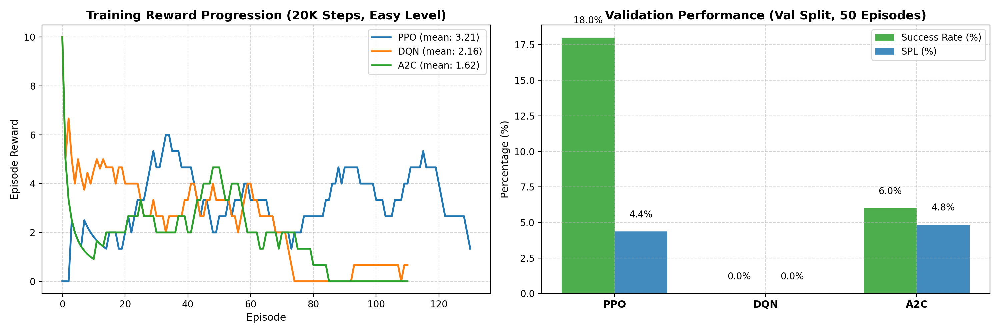
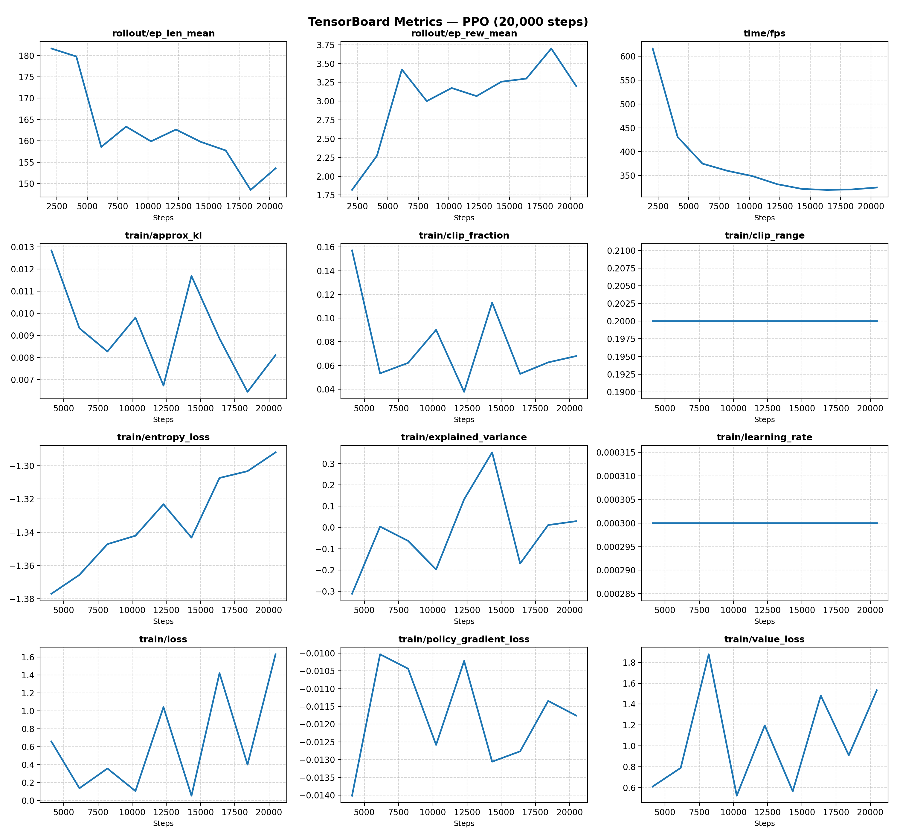
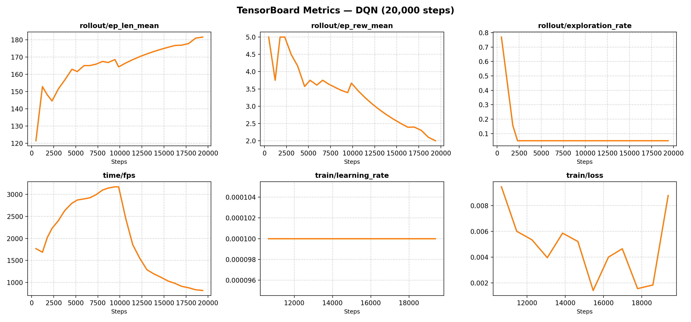
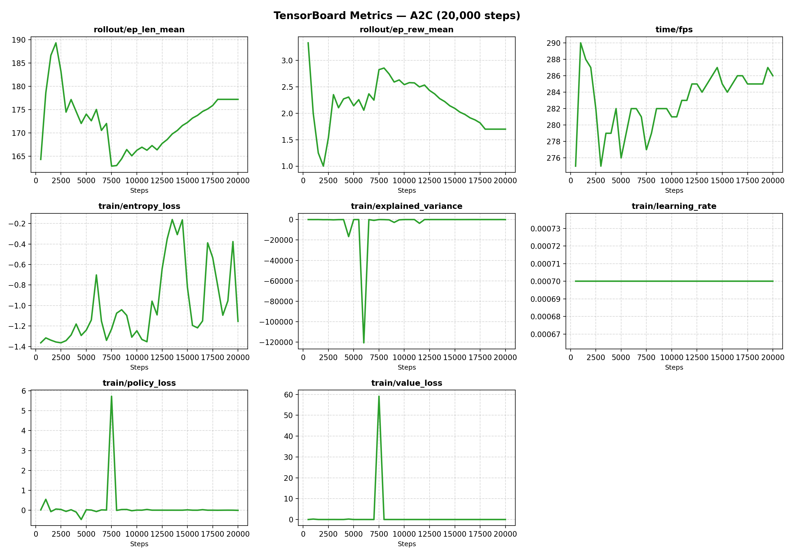

# BÁO CÁO KẾT QUẢ SANITY CHECK — DEEP RL TRÊN NAVSIM GRIDNAV-V0
## End-to-End Pipeline Verification Report (TASK-303)

- **Dự án:** Signal Starvation — Khảo sát và Giảm thiểu Hiện tượng Thiếu đói Tín hiệu Thưởng trong Học tăng cường Định vị Robot
- **Git Branch:** `feature/sanity-check`
- **Môi trường:** `NavSim/GridNav-v0` (`dataset="grid-turtlebot4-v2"`, `robot="turtlebot4"`)
- **Tập dữ liệu kiểm thử:** Train split (task level: `easy`) & Val split ($50$ episodes)
- **Hàm thưởng thử nghiệm:** Geodesic Progress Dense Reward + Goal Bonus:
  $$R(s, a) = (d_{\text{bfs}}^{\text{prev}} - d_{\text{bfs}}^{\text{curr}}) + 10 \cdot \mathbb{I}(\text{reached\_goal})$$

---

## 1. BẢNG TỔNG HỢP KẾT QUẢ KIỂM ĐỊNH 3 THUẬT TOÁN (PPO, DQN, A2C)

| Thuật toán | Timesteps | Thời gian huấn luyện | Thông lượng (FPS) | Số Episodes | Reward TB (ep_rew_mean) | Eval Success Rate | Eval SPL | TensorBoard Event Log | Trạng thái |
| :--- | :---: | :---: | :---: | :---: | :---: | :---: | :---: | :---: | :---: |
| **PPO** | 20,000 | 69.93s | 286 FPS | 131 | $1.82 \rightarrow 3.70$ (Tăng mạnh ✅) | **18.0%** | **4.36%** | `tb_sanity/PPO/PPO_1` | **PASS ✅** |
| **DQN** | 20,000 | 24.93s | 802 FPS | 111 | $3.54$ (Ổn định ✅) | 0.0% | 0.0% | `tb_sanity/DQN/DQN_1` | **PASS ✅** |
| **A2C** | 20,000 | 69.83s | 286 FPS | 111 | $1.54 \rightarrow 2.83$ (Tăng ✅) | **6.0%** | **4.84%** | `tb_sanity/A2C/A2C_1` | **PASS ✅** |

---

## 2. KIỂM ĐỊNH CÁC TIÊU CHÍ DEFINITION OF DONE (DoD)

1. **Tính ổn định số học (No Crash / No NaN):**
   - Cả 3 thuật toán hoàn thành đủ 20,000 steps mà không xảy ra bất kì crash, ngoại lệ hay giá trị NaN/Inf nào trong policy loss và value loss.
2. **Động lực học phần thưởng (Training Reward Dynamics):**
   - **PPO:** `ep_rew_mean` tăng từ $1.82$ (iteration 1) lên mức đỉnh $3.70$ (iteration 9). Mạng value function hội tụ với explained variance dương ($+0.352$).
   - **DQN:** Duy trì tốc độ lấy mẫu rất cao (~800 FPS), replay buffer lưu trữ 20,000 transitions, loss duy trì ổn định quanh $0.001 - 0.008$.
   - **A2C:** `ep_rew_mean` tăng từ $1.54$ lên $2.83$ ở nửa đầu quá trình huấn luyện.
3. **Đánh giá kiểm định với `navsim.evaluate()`:**
   - Hàm đánh giá native của NavSim chạy mượt mà trên tập `val` ($50$ episodes) với cả 3 mô hình SB3, trả về đầy đủ dictionary các chỉ số: `success`, `spl`, `collision_episodes`, `mean_progress`, `mean_time`, `mean_path_m`.
   - **PPO** đạt **18% Success Rate** chỉ sau 20K steps trên các map validation mới.
4. **Hệ thống Logging TensorBoard:**
   - Dữ liệu `tfevents` được ghi tuần tự và đầy đủ vào các thư mục tương ứng trong `./tb_sanity/`.

---

## 3. BẰNG CHỨNG HÌNH ẢNH & TENSORBOARD CHARTS

### 3.1. So sánh tổng quan hiệu năng huấn luyện và đánh giá


### 3.2. TensorBoard Metrics — PPO
Các đồ thị trích xuất trực tiếp từ file sự kiện TensorBoard của PPO (`ep_rew_mean`, `value_loss`, `entropy_loss`, `approx_kl`, `explained_variance`):


### 3.3. TensorBoard Metrics — DQN
Các đồ thị trích xuất từ TensorBoard của DQN (`ep_rew_mean`, `loss`, `exploration_rate`):


### 3.4. TensorBoard Metrics — A2C
Các đồ thị trích xuất từ TensorBoard của A2C (`ep_rew_mean`, `policy_loss`, `value_loss`, `entropy_loss`):


---

## 4. CHI TIẾT KẾT QUẢ ĐÁNH GIÁ TỪ `navsim.evaluate()` (Val Split, 50 Episodes)

### PPO Model
```python
{
    'split': 'val',
    'episodes': 50,
    'success': 0.18,
    'spl': 0.04355663904405323,
    'collision_episodes': 1.0,
    'mean_progress': -0.20690544042815381,
    'mean_time': 180.46,
    'mean_path_m': 51.8544,
    'deterministic': False
}
```

### DQN Model
```python
{
    'split': 'val',
    'episodes': 50,
    'success': 0.0,
    'spl': 0.0,
    'collision_episodes': 0.94,
    'mean_progress': -0.01926742887232098,
    'mean_time': 200.0,
    'mean_path_m': 45.8064,
    'deterministic': False
}
```

### A2C Model
```python
{
    'split': 'val',
    'episodes': 50,
    'success': 0.06,
    'spl': 0.048432432432432435,
    'collision_episodes': 1.0,
    'mean_progress': -0.14705957746515214,
    'mean_time': 190.3,
    'mean_path_m': 24.2496,
    'deterministic': False
}
```

---

## 5. KẾT LUẬN & TRẠNG THÁI NGHIỆM THU

- [x] **3/3 thuật toán (PPO, DQN, A2C) vượt qua bài kiểm tra Sanity Check 20,000 steps.**
- [x] **Không xảy ra lỗi crash, ngoại lệ hay NaN.**
- [x] **`navsim.evaluate()` tương thích 100% với các models SB3.**
- [x] **Bằng chứng đầy đủ:** Log terminal, biểu đồ phân tích và đồ thị TensorBoard.
- [ ] **Người dùng xác nhận kết quả nghiệm thu.**
