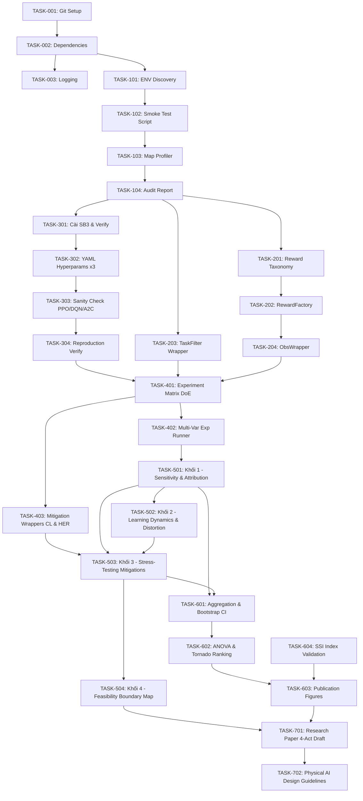

# 📋 PRODUCT BACKLOG — Signal Starvation Research Project

> **Ngữ cảnh:** Nghiên cứu khảo sát tác động của các đặc trưng môi trường (*environmental properties*) đến hiệu suất Deep Reinforcement Learning trong Physical AI.
>
> **Môi trường mô phỏng:** NavSim (`F:\navsim`) + Datasets tại `F:\navsim\datasets`.
>
> **Thuật toán DRL:** PPO, DQN, A2C — sử dụng **Stable-Baselines3** (Raffin et al., JMLR 2021). Không implement lại từ đầu.
>
> **Quy ước:** Người dùng phê duyệt từng task trước khi Agent thực thi. Agent không tự ý code khi chưa được kích hoạt.

---

## 🔬 Kết quả Smoke Test Ban đầu (Đã chạy — 2026-11-06)

> Kết quả kiểm thử thực tế sau khi cài navsim và chạy random agent 200 steps.

| Hạng mục | Kết quả |
|---|---|
| **NavSim version** | `0.1.0` — cài từ `F:\navsim\navsim-0.1.0-py3-none-any.whl` ✅ |
| **Python** | `3.13.11` ✅ |
| **Datasets path** | `F:\navsim\datasets` (env var `NAVSIM_DATASETS`) ✅ |
| **Datasets có sẵn** | 9 grid datasets + 2 demo (xem bảng dưới) |
| **Môi trường hoạt động** | `NavSim/GridNav-v0` — PASS, không crash ✅ |
| **Observation Space** | `Box(0.0, 10.0, (22,), float32)` — 1D flat vector |
| **Action Space** | `Discrete(4)` |
| **Reset time** | `~0.01s` |
| **Step FPS** | `~36,000 FPS` (CPU, numba) 🚀 |
| **Reward mặc định** | `0.0` cho mọi step — 100% sparse by design |
| **`info` keys** | `start, goal, d_bfs, p0, sa_uniform, sa_persist, starved, level, map_id, task_id, split` |

### 📦 Datasets Có sẵn tại `F:\navsim\datasets`

| Dataset | Robot | Môi trường | Số Maps (ước tính) |
|---|---|---|---|
| `grid-turtlebot4-v2` | turtlebot4 | GridNav-v0 | ~138 |
| `grid-turtlebot4_lite-v2` | turtlebot4_lite | GridNav-v0 | ~130+ |
| `grid-jetauto_pro-v2` | jetauto_pro | GridNav-v0 | ~143 |
| `grid-clearpath_jackal-v2` | clearpath_jackal | GridNav-v0 | ~103 |
| `grid-kobuki-v2` | kobuki | GridNav-v0 | ~130+ |
| `grid-pal_tiago-v2` | pal_tiago | GridNav-v0 | ~130+ |
| `grid-turtlebot3_burger-v2` | turtlebot3_burger | GridNav-v0 | ~130+ |
| `grid-turtlebot3_waffle_pi-v2` | turtlebot3_waffle_pi | GridNav-v0 | ~130+ |
| `grid-agilex_limo-v2` | agilex_limo | GridNav-v0 | ~130+ |
| `demo-grid` | jetauto_pro | GridNav-v0 | 6 (demo) |
| `demo-svg` | turtlebot4, jackal | Nav-v0 (SVG) | 6 (demo) |

> [!IMPORTANT]
> **Phát hiện quan trọng:** Mỗi task trong dataset đã được **pre-label** sẵn với các chỉ số Signal Starvation:
> - `starved` (bool): task có bị signal-starved hay không
> - `level`: `'easy'` / `'medium'` / `'hard'` / `'starved'` — phân loại mức độ khó
> - `sa_uniform`: P(reach goal | uniform random policy) — đo lường độ thưa tín hiệu
> - `sa_persist`: P(reach goal | persistent random policy)
> - `d_bfs`: Khoảng cách BFS (cells) từ start → goal
> - `dist_bin`: Phân nhóm khoảng cách `'1-3'`, `'3-6'`, `'6-10'`, `'10-15'`
>
> **Phân phối level (100 resets, grid-turtlebot4-v2, train):**
> `easy: 31%`, `medium: 38%`, `hard: 7%`, `starved: 24%`
>
> **Ý nghĩa nghiên cứu:** Không cần tự định nghĩa $\rho_{sig}$ thủ công — dataset đã cung cấp sẵn `sa_uniform` như một định lượng chính xác của Signal Starvation! Đây là **biến độc lập chính** của thực nghiệm.

---

## Quy ước Ưu tiên & Trạng thái

| Ký hiệu | Nghĩa |
|---|---|
| 🔴 **P0** | Bắt buộc — Blocker cho toàn bộ dự án |
| 🟠 **P1** | Cao — Nền tảng cho ma trận khảo sát |
| 🟡 **P2** | Trung bình — Mở rộng phân tích |
| 🟢 **P3** | Thấp — Nice-to-have / Tương lai |
| ⬜ `TODO` | Chưa bắt đầu |
| 🔵 `IN PROGRESS` | Đang thực hiện |
| ✅ `DONE` | Hoàn thành & đã xác nhận |
| ❌ `BLOCKED` | Bị chặn bởi dependency |

---

## EPIC 0 — Khởi tạo Dự án & Quản trị (Project Setup & Governance)

> **Mục tiêu:** Dựng khung hạ tầng kỹ thuật, quy trình Git, và bộ công cụ theo dõi thực nghiệm.

### TASK-001 · Khởi tạo Git Repository & Cấu trúc Thư mục
- **Ưu tiên:** 🔴 P0 | **Trạng thái:** ⬜ TODO
- **Mô tả:** Tạo Git repo chính thức cho dự án tại `F:\Signal Starvation`, thiết lập cấu trúc thư mục chuẩn.
- **Chi tiết thực thi:**
  - Khởi tạo `git init`, tạo `.gitignore` phù hợp (loại trừ checkpoints nặng, `__pycache__`, `.env`)
  - Tạo nhánh `main` → `dev` theo chiến lược branching đã quy định
  - Dựng cấu trúc thư mục dự án:
    ```
    F:\Signal Starvation\
    ├── Documentation\         ← Tài liệu giao thức (đã có)
    ├── src\
    │   ├── agents\            ← Config & wrapper SB3 agents (PPO, DQN, A2C)
    │   ├── envs\              ← Wrappers môi trường NavSim
    │   ├── rewards\           ← Các hàm reward khác nhau
    │   ├── experiment\        ← Ma trận thực nghiệm & scripts chạy
    │   └── analysis\          ← Scripts phân tích thống kê
    ├── configs\               ← YAML configs cho từng thực nghiệm
    ├── audit_reports\         ← Báo cáo audit môi trường
    ├── results\               ← Kết quả thực nghiệm (CSV, JSON)
    ├── notebooks\             ← Colab notebooks cho training
    ├── backlog.md             ← File này
    └── README.md
    ```
  - Tạo file `README.md` tóm tắt dự án, nêu rõ `NAVSIM_DATASETS=F:\navsim\datasets`
- **Tiêu chí DoD:**
  - `git log` hiển thị initial commit với cấu trúc đầy đủ
  - Có thể `git checkout -b feature/<tên-task>` từ `dev`
- **Ước tính:** 1–2 giờ

---

### TASK-002 · Cài đặt & Xác minh Môi trường Python (Dependencies Audit)
- **Ưu tiên:** 🔴 P0 | **Trạng thái:** ✅ DONE (một phần)
- **Ghi chú:** NavSim `0.1.0` đã được cài thành công từ wheel local. Gymnasium, numba, pettingzoo, matplotlib đã sẵn sàng. Cần bổ sung các DRL-specific packages.
- **Mô tả:** Bổ sung và verify các dependencies còn thiếu, tạo `requirements.txt` chuẩn.
- **Chi tiết thực thi:**
  - **Đã có:** `navsim 0.1.0`, `gymnasium 1.4.0`, `numpy 2.3.5`, `scipy 1.17.0`, `numba 0.63.1`, `matplotlib 3.10.8`, `pettingzoo 1.27.0`
  - **Cần cài thêm:**
    - `stable-baselines3`, `sb3-contrib` — DRL training
    - `torch` — PyTorch backend cho SB3
    - `pandas` — xử lý CSV kết quả
    - `seaborn` — visualization
    - `tensorboard` — training logging
    - `pyyaml`, `omegaconf` — config management
    - `statsmodels` — kiểm định thống kê
  - Thiết lập biến môi trường: `NAVSIM_DATASETS=F:\navsim\datasets`
  - Tạo `requirements.txt` với version pinning rõ ràng
  - Tạo script `scripts/check_env.py` verify tất cả imports + in ra versions
- **Tiêu chí DoD:**
  - `python scripts/check_env.py` chạy không lỗi
  - `import stable_baselines3; import torch` thành công
- **Ước tính:** 1–2 giờ

---

### TASK-003 · Thiết lập Experiment Tracking & Logging Infrastructure
- **Ưu tiên:** 🟠 P1 | **Trạng thái:** ⬜ TODO
- **Mô tả:** Xây dựng hệ thống ghi lại metrics training/evaluation, đảm bảo mọi thực nghiệm đều có audit trail đầy đủ.
- **Chi tiết thực thi:**
  - Thiết lập **TensorBoard** cho real-time training curves
  - Tạo class `ExperimentLogger` tại `src/experiment/logger.py`:
    - Ghi `train_metrics.csv` (episode, reward, steps, time)
    - Ghi metadata thực nghiệm: seed, config hash, git commit hash
    - Tự động tạo thư mục `results/<experiment_name>/<timestamp>/`
  - Thiết kế chuẩn file kết quả `.csv`:
    ```
    experiment_id, seed, algorithm, dataset, robot, reward_type, level_filter,
    episode, total_reward, success, steps_to_goal, collision_count,
    spl, mean_progress, sa_uniform_mean, training_time_s, eval_timestamp
    ```
    > Lưu ý: thêm cột `sa_uniform_mean` và `level_filter` vì đây là biến nghiên cứu chính
  - Tạo class `ConfigManager` đọc YAML configs, lưu config snapshot vào thư mục kết quả
  - Script `scripts/aggregate_results.py` gom kết quả nhiều seeds thành bảng tổng hợp
- **Tiêu chí DoD:**
  - Chạy mock experiment → xuất ra file CSV đúng chuẩn
  - TensorBoard hiển thị được log
- **Ước tính:** 3–5 giờ

---

## EPIC 1 — Audit Môi trường & Baseline Profiling

> **Mục tiêu:** Hoàn thiện tài liệu kỹ thuật về môi trường NavSim/GridNav-v0, lập báo cáo audit chính thức dựa trên dữ liệu smoke test đã có.

> [!NOTE]
> TASK-102 (smoke test GridNav-v0) đã được thực thi thủ công trong quá trình khám phá. Cần hoàn thiện script chính thức và báo cáo.

### TASK-101 · Environment Resource Discovery & API Inspection (Hoàn thiện)
- **Ưu tiên:** 🔴 P0 | **Trạng thái:** 🔵 IN PROGRESS (đã khảo sát một phần)
- **Branch:** `feature/env-audit-baseline`
- **Mô tả:** Tổng hợp tài liệu kỹ thuật đầy đủ về NavSim API và cấu trúc datasets mới.
- **Chi tiết thực thi:**
  - **Đã biết từ smoke test:**
    - Môi trường chính: `NavSim/GridNav-v0` (action: `Discrete(4)`, obs: `Box(22,)`)
    - 9 datasets grid, mỗi dataset cho 1 robot model
    - `info` có sẵn: `d_bfs`, `sa_uniform`, `sa_persist`, `starved`, `level`, `dist_bin`
  - **Cần hoàn thiện thêm:**
    - Đếm chính xác số maps theo split (train/val/test) cho từng dataset
    - Đọc robot JSON files → bảng tóm tắt footprint, v_max, lidar_range của 9 robots
    - Hiểu cấu trúc grid JSON: `W`, `H`, `free_cells`, `main_cells`, `main_frac`, `cell_m` → dùng để tính $C_{topo}$
    - Kiểm tra `Nav-v0` (SVG continuous) có hoạt động với `demo-svg` không
    - Lập `audit_reports/ENV_RESOURCE_REPORT.md`
- **Tiêu chí DoD:**
  - Có bảng đầy đủ action/observation spaces + số maps/tasks theo split
  - Người dùng xác nhận báo cáo
- **Ước tính:** 2–3 giờ

---

### TASK-102 · Smoke Test Script Chính thức — GridNav-v0
- **Ưu tiên:** 🔴 P0 | **Trạng thái:** 🔵 IN PROGRESS (đã chạy thủ công, cần script chuẩn hóa)
- **Branch:** `feature/env-audit-baseline`
- **Mô tả:** Viết script smoke test chính thức, tái hiện kết quả đã biết, và xuất bằng chứng CSV/PNG.
- **Kết quả đã biết:**
  ```
  Môi trường:   NavSim/GridNav-v0, grid-turtlebot4-v2, train
  Obs Space:    Box(0.0, 10.0, (22,), float32)
  Action Space: Discrete(4)
  Reset time:   ~0.01s
  Step FPS:     ~36,000 FPS
  Reward:       0.0 (100% sparse)
  Level dist:   easy 31%, medium 38%, hard 7%, starved 24%
  d_bfs range:  [8, 67], mean=23.1
  sa_uniform:   mean=0.111 (11.1% chance random agent reaches goal)
  ```
- **Chi tiết thực thi:**
  - Viết `audit_reports/smoke_test_gridnav.py`:
    - Chạy 1000 steps random agent, lấy statistics đầy đủ
    - Test 3 splits: train / val / test
    - Xuất `audit_reports/logs/gridnav_random_1000steps.csv`
    - Xuất `audit_reports/logs/gridnav_episode.png` (render frame)
    - Phân tích phân phối `sa_uniform` theo level → plot histogram
  - Test thêm với dataset `grid-jetauto_pro-v2` và `grid-clearpath_jackal-v2` để so sánh robot
- **Tiêu chí DoD:**
  - Script chạy không lỗi, xuất CSV + PNG
  - Kết quả khớp với smoke test thủ công
- **Ước tính:** 2–3 giờ

---

### TASK-103 · Phân tích Topological Complexity — Map Profiler
- **Ưu tiên:** 🟠 P1 | **Trạng thái:** ✅ DONE
- **Branch:** eature/env-audit-baseline
- **Mô tả:** Tính toán và phân loại {topo}$ từ grid JSON files để dùng làm biến thực nghiệm V2.
- **Chi tiết thực thi:**
  - Đã viết src/experiment/map_profiler.py:
    - Đọc grid .json → trích xuất ree_cells, main_cells, main_frac, W, H, cell_m
    - Tính **obstacle density**: 1 - main_frac (tỷ lệ ô không đi được, mean=0.0907)
    - Tính **navigable area** (m²): main_cells × cell_m² (range: [11.02, 145.41] m², mean=42.66 m²)
    - Phân loại map complexity: Small/Medium/Large dựa trên main_m2
  - Đã chạy profiler trên toàn bộ 138 maps trong grid-turtlebot4-v2:
    - Xuất udit_reports/map_complexity_profile.csv (138 maps)
    - Xuất udit_reports/task_complexity_profile.csv (2,760 tasks)
    - Plot distribution của main_frac, main_m2, ree_cells xuất tại udit_reports/map_distribution.png và udit_reports/logs/map_complexity_distribution.png
    - Plot distribution của tasks theo sa_uniform, d_bfs, level xuất tại udit_reports/task_distribution.png
  - Bảng phân nhóm Map Scale ({topo}$):
    | Nhóm | Tiêu chí (Tertile) | Tiêu chí (Ngưỡng tròn) | Số maps | Tỷ lệ (%) |
    |---|---|---|---|---|
    | **Small** | main_m2 < 28.34 m² | main_m2 < 30.0 m² | 46 (tertile) / 51 (tròn) | 33.3% / 37.0% |
    | **Medium** | 28.34 ≤ main_m2 < 46.27 m² | 30.0 ≤ main_m2 < 50.0 m² | 46 (tertile) / 50 (tròn) | 33.3% / 36.2% |
    | **Large** | main_m2 ≥ 46.27 m² | main_m2 ≥ 50.0 m² | 46 (tertile) / 37 (tròn) | 33.3% / 26.8% |
  - Bảng phân loại Tasks ($
ho_{sig}$ - Độ khó môi trường thực tế):
    | Nhóm (Level) | Tiêu chí \_uniform$ | Số tasks | Tỷ lệ (%) | {bfs}$ (mean) | \_uniform$ (mean) |
    |---|---|---|---|---|---|
    | **easy** | \_uniform \ge 0.10$ | 953 | 34.5% | 9.4 cells | 0.2946 |
    | **medium** | .001 \le sa\_uniform < 0.10$ | 938 | 34.0% | 21.1 cells | 0.0268 |
    | **hard** | .0001 \le sa\_uniform < 0.001$ | 265 | 9.6% | 31.8 cells | 0.0004 |
    | **starved** | \_uniform < 0.0001$ | 604 | 21.9% | 44.2 cells | 0.000015 |
- **Tiêu chí DoD:**
  - Có bảng phân loại tasks dựa trên dữ liệu thực ✅
  - Plot distribution xuất được ✅ (udit_reports/map_distribution.png, udit_reports/task_distribution.png)
  - Unit tests 	ests/test_map_profiler.py PASS ✅ (3/3 passed)
- **Ước tính:** 3–5 giờ

---

### TASK-104 · Environment Profiling Report — Báo cáo Audit Chính thức
- **Ưu tiên:** 🔴 P0 | **Trạng thái:** ⬜ IN REVIEW (Chờ phê duyệt & merge)
- **Branch:** `feature/env-audit-baseline`
- **Mô tả:** Tổng hợp TASK-101/102/103 thành báo cáo audit hoàn chỉnh để commit và Người dùng phê duyệt.
- **Chi tiết thực thi:**
  - Tạo `audit_reports/ENV_AUDIT_REPORT.md` với bảng định lượng:

    | Thuộc tính | Giá trị Thực tế | Nguồn |
    |---|---|---|
    | **Env type** | `GridNav-v0` (Discrete) | Smoke test |
    | **Obs shape** | `Box(0.0, 10.0, (22,), float32)` | Smoke test |
    | **Action space** | `Discrete(4)` | Smoke test |
    | **Step FPS** | `~36,000` | Smoke test |
    | **Reward** | `0.0` by default (100% sparse) | Design |
    | **$\rho_{sig}$ proxy** | `1 - sa_uniform` per task | Dataset labels |
    | **$C_{topo}$ proxy** | `1 - main_frac` per map | Grid JSON |
    | **Level labels** | easy / medium / hard / starved | Dataset labels |
    | **d_bfs range** | [8, 67] cells, mean=23.1 | Smoke test |
    | **sa_uniform range** | [~0, ~0.59], mean=0.111 | Smoke test |

  - **Điểm chốt quan trọng:** NavSim dataset đã pre-compute `sa_uniform` per task → đây chính là $\rho_{sig}$ quantitative được tính toán từ MDP, không cần ước tính thủ công
  - Commit báo cáo lên `feature/env-audit-baseline`, tạo PR vào `dev`
- **Tiêu chí DoD:**
  - Người dùng phê duyệt báo cáo
  - Branch merge vào `dev`
- **Ước tính:** 2–3 giờ

---

## EPIC 2 — Thiết kế Reward & Wrapper Infrastructure

> **Mục tiêu:** Xây dựng hệ thống reward functions linh hoạt — **biến thực nghiệm chủ chốt** kiểm soát mức độ Signal Starvation ở chiều reward shaping (không phải ở chiều task selection vì dataset đã có `sa_uniform`).

> [!NOTE]
> Với dataset đã có `sa_uniform` per task, nghiên cứu có **2 trục Signal Starvation độc lập** có thể khảo sát riêng hoặc kết hợp:
> - **Trục A (Task-level):** Filter tasks theo `level` hoặc `sa_uniform` → kiểm soát độ khó task
> - **Trục B (Reward-level):** Thiết kế reward function sparse/dense → kiểm soát mật độ tín hiệu reward

### TASK-201 · Nghiên cứu & Phân loại Reward Function Taxonomy
- **Ưu tiên:** 🟠 P1 | **Trạng thái:** ⬜ TODO
- **Branch:** `feature/reward-design`
- **Mô tả:** Lập khung phân loại reward functions từ sparse đến dense, mapping lên Trục B Signal Starvation.
- **Chi tiết thực thi:**
  - **R1: Pure Sparse** — `+1` chỉ khi `state.reached_goal` (maximum signal starvation ở chiều reward)
  - **R2: Collision-Penalized Sparse** — `+1 goal, -0.5 collision` (vẫn sparse nhưng có negative signal)
  - **R3: Distance-Based Dense** — `-d_bfs_normalized` per step (signal mỗi bước dựa trên khoảng cách BFS)
  - **R4: Progress Dense** — `d_bfs(prev) - d_bfs(now)` (reward = số cells tiến gần goal)
  - **R5: Progress + Goal Bonus** — R4 + `10 * reached_goal - 0.01 * step_penalty`
  - **R6: Potential-Based Shaped** — `Φ(s') - Φ(s)` với `Φ = -d_bfs` (lý thuyết giữ nguyên optimal policy)
  - Tham chiếu paper: Ng et al. (1999), Ziebart (2010)
  - Tạo `Documentation/reward_taxonomy.md` với định nghĩa toán học
- **Tiêu chí DoD:**
  - Có bảng phân loại với ký hiệu toán học rõ ràng
  - Người dùng duyệt taxonomy
- **Ước tính:** 3–4 giờ

---

### TASK-202 · Implement RewardFactory — Modular Reward System
- **Ưu tiên:** 🟠 P1 | **Trạng thái:** ✅ DONE
- **Branch:** `feature/reward-design`
- **Mô tả:** Code hệ thống reward pluggable dùng `navsim.wrappers.Reward` API.
- **Chi tiết thực thi:**
  - Đã tạo `src/rewards/base_reward.py`: abstract class `BaseReward`
  - Đã implement 6 reward classes (R1–R6) kế thừa `BaseReward`:
    - `PureSparseReward` (R1)
    - `CollisionPenalizedSparseReward` (R2)
    - `DistanceBasedDenseReward` (R3)
    - `ProgressDenseReward` (R4)
    - `ProgressGoalReward` (R5)
    - `PotentialBasedShapedReward` (R6)
  - R3/R4 sử dụng `info['d_bfs']` và `info['progress']` / `info['goal_geodesic']`
  - Đã tạo `src/rewards/reward_factory.py`: `make_reward`, `wrap_env_with_reward`, `register_reward`
  - Wrapper: `navsim.wrappers.Reward(env, lambda state, info: reward_fn(state, info))`
  - Unit tests: `tests/test_rewards.py` (29 tests PASS, chạy 100 steps với mỗi reward type không crash)
  - File mẫu: `configs/reward_r4.yaml`
- **Tiêu chí DoD:**
  - `pytest tests/test_rewards.py` PASS ✅ (29 passed in 0.80s)
  - Chạy 100 steps với mỗi reward type không crash ✅ (6/6 reward types passed)
- **Ước tính:** 4–6 giờ

---

### TASK-203 · Implement TaskFilter Wrapper — Curriculum theo Level & sa_uniform
- **Ưu tiên:** 🟠 P1 | **Trạng thái:** ✅ DONE
- **Branch:** `feature/reward-design`
- **Mô tả:** Xây dựng wrapper kiểm soát Trục A Signal Starvation — filter tasks theo `level` hoặc `sa_uniform`.
- **Chi tiết thực thi:**
  - Sử dụng `env.unwrapped.set_task_filter(level='easy')` hoặc `set_task_filter(level=['easy', 'medium'])`
  - Tạo `src/envs/task_filter_wrapper.py`:
    - `LevelFilter(env, levels=['easy'])` — chỉ train trên tasks dễ
    - `SAFilter(env, sa_min=0.1, sa_max=1.0)` — filter theo `sa_uniform` range
    - `StarvedFilter(env, include_starved=False)` — loại bỏ / chỉ chọn tasks starved
  - Đây là **biến thực nghiệm V1-TaskLevel** trong ma trận khảo sát
  - Viết unit tests verify đúng filter hoạt động
- **Tiêu chí DoD:**
  - Sau khi set filter, 100 resets đều trả về tasks thuộc đúng level được chọn
- **Ước tính:** 2–4 giờ

---

### TASK-204 · Implement ObservationWrapper — Chuẩn hóa Observation Space
- **Ưu tiên:** 🟡 P2 | **Trạng thái:** ⬜ TODO
- **Branch:** `feature/reward-design`
- **Mô tả:** Chuẩn hóa và bổ sung observation cho các DRL agents (GridNav đã là flat vector 22 chiều).
- **Chi tiết thực thi:**
  - GridNav-v0 observation: `Box(0.0, 10.0, (22,), float32)` — đã flat, không cần flatten
  - Tạo `src/envs/obs_wrappers.py`:
    - `NormalizeObsWrapper`: normalize về [0, 1] (optional, SB3 tự normalize được)
    - `AppendInfoWrapper`: thêm `sa_uniform`, `d_bfs` vào observation (optional experiment)
    - `StackedFramesWrapper`: stack N observations liên tiếp (kiểm tra POMDP effect)
  - Viết unit tests verify shape, dtype, range
- **Tiêu chí DoD:**
  - `pytest tests/test_obs_wrappers.py` PASS
- **Ước tính:** 2–3 giờ

---

## EPIC 3 — Tích hợp Thuật toán DRL via Stable-Baselines3

> **Mục tiêu:** Cài đặt, cấu hình và xác minh các thuật toán DRL từ **Stable-Baselines3** — không implement lại từ đầu. Tập trung vào đúng hyperparameters, logging chuẩn và Sanity Check bắt buộc.

> [!NOTE]
> **Quyết định thiết kế:** PPO, DQN, A2C đã có sẵn trong `stable-baselines3` (Raffin et al., JMLR 2021 — peer-reviewed, cite được). Các task trong EPIC này tập trung vào **cài đặt + cấu hình + xác minh**, không phải viết lại thuật toán.

> [!IMPORTANT]
> Dù dùng SB3, **Sanity Check và Reproduction Verification vẫn BẮT BUỘC** theo `research_protocol.md` — đây là minh chứng khoa học rằng pipeline hoạt động đúng trên môi trường cụ thể của dự án.

### TASK-301 · Cài đặt Stable-Baselines3 & Xác minh Tương thích
- **Ưu tiên:** 🔴 P0 | **Trạng thái:** ✅ DONE
- **Branch:** `feature/sb3-setup`
- **Mô tả:** Cài SB3 + các dependencies DRL, xác nhận tương thích hoàn toàn với NavSim GridNav-v0.
- **Lý do chọn SB3:**
  - ✅ Peer-reviewed: Raffin et al., *JMLR 2021* — [paper](https://jmlr.org/papers/v22/20-1364.html)
  - ✅ Gymnasium-native — NavSim dùng Gymnasium API
  - ✅ DQN + PPO + A2C cho `Discrete(4)` action space
  - ✅ TensorBoard built-in, EvalCallback, CheckpointCallback
  - ✅ `navsim.evaluate(model, env)` tích hợp thẳng với SB3 model
- **Chi tiết thực thi:**
  - Cài packages:
    ```bash
    pip install "stable-baselines3[extra]" sb3-contrib tensorboard pandas seaborn statsmodels omegaconf
    ```
  - Thiết lập biến môi trường vĩnh viễn `NAVSIM_DATASETS=F:\navsim\datasets`
  - Tạo `scripts/check_env.py` verify đầy đủ:
    ```python
    import stable_baselines3, torch, gymnasium, navsim, tensorboard
    # Print versions + quick env test
    ```
  - Tạo `Documentation/algorithm_references.md`:

    | Thuật toán | Loại | Paper gốc | SB3 Class | Action Space |
    |---|---|---|---|---|
    | **PPO** | On-policy | Schulman et al., 2017 | `PPO('MlpPolicy', env)` | Discrete ✅ |
    | **DQN** | Off-policy | Mnih et al., 2015 | `DQN('MlpPolicy', env)` | Discrete ✅ |
    | **A2C** | On-policy | Mnih et al., 2016 | `A2C('MlpPolicy', env)` | Discrete ✅ |

- **Tiêu chí DoD:**
  - `python scripts/check_env.py` → tất cả `[OK]`, in ra versions
  - `from stable_baselines3 import PPO, DQN, A2C` không lỗi
- **Ước tính:** 1–2 giờ

---

### TASK-302 · Cấu hình Hyperparameters — YAML Configs cho 3 Thuật toán
- **Ưu tiên:** 🔴 P0 | **Trạng thái:** ✅ DONE
- **Branch:** `feature/sb3-setup`
- **Mô tả:** Thiết lập file YAML hyperparameters chuẩn theo paper gốc cho PPO, DQN, A2C. Đây là bước thay thế cho "implement agent" — cấu hình đúng là đảm bảo tính khoa học.
- **Chi tiết thực thi:**
  - Tạo `configs/ppo_default.yaml`:
    ```yaml
    # Schulman et al. (2017) — arXiv:1707.06347
    algorithm: ppo
    policy: MlpPolicy
    learning_rate: 3.0e-4
    n_steps: 2048
    batch_size: 64
    n_epochs: 10
    gamma: 0.99
    gae_lambda: 0.95
    clip_range: 0.2
    ent_coef: 0.01       # > 0 để khuyến khích exploration với sparse reward
    vf_coef: 0.5
    max_grad_norm: 0.5
    ```
  - Tạo `configs/dqn_default.yaml`:
    ```yaml
    # Mnih et al. (2015) — Nature doi:10.1038/nature14236
    algorithm: dqn
    policy: MlpPolicy
    learning_rate: 1.0e-4
    buffer_size: 100_000
    learning_starts: 10_000
    batch_size: 32
    tau: 1.0
    gamma: 0.99
    train_freq: 4
    target_update_interval: 1000
    exploration_fraction: 0.1
    exploration_final_eps: 0.05
    ```
  - Tạo `configs/a2c_default.yaml`:
    ```yaml
    # Mnih et al. (2016) — arXiv:1602.01783
    algorithm: a2c
    policy: MlpPolicy
    learning_rate: 7.0e-4
    n_steps: 5
    gamma: 0.99
    gae_lambda: 1.0
    ent_coef: 0.0
    vf_coef: 0.5
    max_grad_norm: 0.5
    ```
  - Tạo `src/agents/agent_factory.py`: hàm `make_agent(config_path, env)` → trả về SB3 model đúng loại
- **Tiêu chí DoD:**
  - `make_agent('configs/ppo_default.yaml', env)` trả về SB3 PPO model không lỗi
  - 3 file YAML hoàn chỉnh với comments trích dẫn paper
- **Ước tính:** 2–3 giờ

---

### TASK-303 · Sanity Check — PPO trên GridNav-v0
- **Ưu tiên:** 🔴 P0 | **Trạng thái:** ✅ DONE
- **Branch:** `feature/sanity-check`
- **Mô tả:** Chạy thử PPO 20,000 steps để xác nhận pipeline NavSim + SB3 hoạt động end-to-end.
- **Chi tiết thực thi:**
  - Viết `scripts/sanity_check.py`:
    ```python
    # Setup
    env = gym.make('NavSim/GridNav-v0', dataset='grid-turtlebot4-v2', robot='turtlebot4', split='train')
    env = navsim.wrappers.Reward(env, lambda state, info: (info['d_bfs_prev'] - info['d_bfs']) + 10 * state.reached_goal)
    env.unwrapped.set_task_filter(level='easy')   # bắt đầu với easy tasks

    # Train PPO 20K steps
    model = PPO('MlpPolicy', env, verbose=1, tensorboard_log='./tb_sanity/')
    model.learn(total_timesteps=20_000)

    # Evaluate
    results = navsim.evaluate(model, 'NavSim/GridNav-v0', dataset='grid-turtlebot4-v2', robot='turtlebot4', split='val')
    print(results)   # success_rate, spl, ...
    ```
  - Điều kiện PASS:
    - Không crash / NaN trong 20,000 steps
    - Training reward tăng theo thời gian (dù chưa converge)
    - `navsim.evaluate()` trả về dict không lỗi
    - TensorBoard log hiển thị được
  - Lặp lại tương tự cho DQN và A2C
  - Xuất `audit_reports/sanity_check_results.md` với log terminal + screenshots TensorBoard
- **Tiêu chí DoD:**
  - 3/3 algorithms (PPO, DQN, A2C) pass sanity check
  - Có bằng chứng: log terminal + TensorBoard screenshots
  - Người dùng xác nhận kết quả
- **Ước tính:** 3–5 giờ

---

### TASK-304 · Reproduction Verification — So khớp Benchmark Chuẩn
- **Ưu tiên:** 🟠 P1 | **Trạng thái:** ⬜ TODO
- **Branch:** `feature/sanity-check`
- **Mô tả:** Xác nhận SB3 với hyperparameters đã cấu hình đạt kết quả khớp tài liệu SB3, sai số ≤ 1.5%.
- **Chi tiết thực thi:**
  - Chạy mỗi algorithm trên benchmark Gymnasium chuẩn (không phụ thuộc NavSim):

    | Algorithm | Benchmark | Target (SB3 docs) | Điều kiện |
    |---|---|---|---|
    | **PPO** | `CartPole-v1` | mean_reward ≈ 500 | 100K steps, 5 seeds |
    | **DQN** | `CartPole-v1` | mean_reward ≈ 500 | 50K steps, 5 seeds |
    | **A2C** | `CartPole-v1` | mean_reward ≈ 500 | 500K steps, 5 seeds |

  - Tính `deviation = |actual - target| / target × 100%`
  - **Nếu deviation > 1.5%:** Kiểm tra lại hyperparameters YAML, không được tiếp tục
  - Lưu kết quả vào `results/reproduction/benchmark_results.csv`
  - Tạo `Documentation/reproduction_report.md` với bảng so sánh chi tiết + link SB3 docs
- **Tiêu chí DoD:**
  - 3/3 algorithms đạt deviation ≤ 1.5%
  - Người dùng phê duyệt `reproduction_report.md`
- **Ước tính:** 3–5 giờ

---

## EPIC 4 — Thiết kế Ma trận Thực nghiệm (Experiment Matrix Design)

> **Mục tiêu:** Xây dựng ma trận khảo sát độ nhạy khách quan (DoE), giải phẫu động học học tập và kiểm chứng giới hạn của các giải pháp can thiệp kinh điển.

### TASK-401 · Xác định Biến Thực nghiệm & Thiết kế Ma trận DoE Khách quan (Revised)
- **Ưu tiên:** 🟠 P1 | **Trạng thái:** 🔵 IN PROGRESS (Đã thiết kế DoE Anchor + Main Effects + Interactions, chờ chốt)
- **Branch:** `feature/experiment-runner`
- **Mô tả:** Thiết kế ma trận thực nghiệm dựa trên nguyên lý Design of Experiments (DoE), tránh ghép cặp cơ học chủ quan.
- **Chi tiết thực thi:**
  - **Biến Độc lập (Independent Variables):**
    - $V_1$: **Task-level Starvation** (`sa_uniform`: easy, medium, hard, starved) — Hệ quả tích hợp của môi trường vật lý
    - $V_2$: **Mật độ Thưởng Môi trường** (R1 Sparse, R3 Distance, R4 Progress, R6 Potential)
    - $V_3$: **Quy mô & Topology Bản đồ** ($C_{topo}$: Small <30m², Medium 30-50m², Large ≥50m²)
    - $V_4$: **Ràng buộc Hình học Thân xe** (TurtleBot 4, JetAuto Pro omni, Clearpath Jackal lớn)
    - $V_5$: **Chiều dài Hành trình Tuyệt đối** (Path Length: 1-3m, 3-6m, 6-10m, 10m+)
    - $V_6$: **Chiến lược Can thiệp Kinh điển** (Baseline M0, Curriculum M1, Goal Relabeling/HER M2, Potential PBRS M3)
  - **3 Trụ cột Metrics Chuẩn (Dependent Metrics — đo trên val/test split):**
    - Trụ cột 1: **Độ chính xác / Tỷ lệ thành công:** Success Rate ($M_1$), SPL ($M_{1b}$), Cumulative Return ($M_2$)
    - Trụ cột 2: **Khả năng tổng quát hóa:** Generalization Gap $\Delta_{gen} = SR_{val} - SR_{test}$ ($M_3$), $\Delta_{SPL}$ ($M_{3b}$)
    - Trụ cột 3: **Hiệu suất mẫu & Tốc độ huấn luyện:** Sample Efficiency $SE_{50}$ ($M_4$), Throughput FPS & Wall Time ($M_5$)
    - Bổ trợ cơ chế: Hệ số tương quan lý thuyết - thực nghiệm $r_{sa} = \text{Corr}(SR, sa\_uniform)$ ($M_6$)
  - **Cấu trúc Khối 1 Tinh gọn (DoE):**
    - Điểm neo quy chuẩn (Anchor): TB4, Medium Map, Medium Path (3-6m), Sparse R1
    - Ma trận 1A (Main Effects): Quét đơn biến qua 4 yếu tố quanh điểm neo (11 configs) $\to$ Tornado Sensitivity Plot
    - Ma trận 1B (Critical Interactions): Đo 2 tương tác cốt lõi:
      - Tương tác 1: Robot Model $\times$ Path Length (3 $\times$ 4 = 12 configs)
      - Tương tác 2: Task Starvation $\times$ Reward Density (4 $\times$ 4 = 16 configs)
    - Tổng Khối 1: 32 configs độc lập $\times$ 2 algos $\times$ 5 seeds = **320 runs**
  - Viết hoàn chỉnh `Documentation/experiment_matrix.md`
- **Tiêu chí DoD:**
  - Ma trận DoE được Người dùng review và chốt design
- **Ước tính:** 3–5 giờ

---

### TASK-402 · Xây dựng Experiment Runner Đa biến — Tự động hóa Ma trận
- **Ưu tiên:** 🟠 P1 | **Trạng thái:** ⬜ TODO
- **Branch:** `feature/experiment-runner`
- **Mô tả:** Code hệ thống tự động chạy toàn bộ ma trận đa biến từ config YAML, hỗ trợ nhiều robot và GPU acceleration.
- **Chi tiết thực thi:**
  - Tạo `src/experiment/runner.py`:
    - Đọc YAML ma trận $\to$ sinh danh sách runs tự động theo cấu hình DoE (Anchor, Sweeps, Interactions)
    - Tự động chuyển đổi dataset theo robot (`grid-turtlebot4-v2`, `grid-jetauto_pro-v2`, `grid-clearpath_jackal-v2`)
    - Chạy từng run, ghi CSV ngay sau mỗi run (crash-safe)
    - Hỗ trợ `--resume` (bỏ qua runs đã hoàn thành), `--dry-run` (liệt kê danh sách runs mà không chạy)
    - Tích hợp CUDA device detection (`--device cuda` trên NVIDIA RTX 3050 Laptop GPU)
  - Tạo `configs/experiment_block1.yaml` (cấu hình 32 configs Khối 1)
- **Tiêu chí DoD:**
  - `--dry-run` liệt kê chính xác 32 configs / 320 runs của Khối 1
  - Chạy thử 2 demo runs trên GPU, xuất CSV đầy đủ metrics
- **Ước tính:** 5–8 giờ

---

### TASK-403 · Triển khai Các Phương Pháp Can Thiệp Kinh Điển (Curriculum Learning & Goal Relabeling / HER)
- **Ưu tiên:** 🟠 P1 | **Trạng thái:** ⬜ TODO
- **Branch:** `feature/mitigations`
- **Mô tả:** Triển khai các module can thiệp chuẩn DRL để chuẩn bị cho Khối 3 (Stress-Testing).
- **Chi tiết thực thi:**
  - **Curriculum Learning Module (`src/envs/curriculum_wrapper.py`):**
    - `SpatialCurriculum`: Tăng dần chiều dài hành trình từ $1-3\text{m} \to 10\text{m}+$ khi $SR \ge 70\%$
    - `SACurriculum`: Hạ dần ngưỡng $sa\_uniform$ từ dễ ($sa \ge 0.15$) sang khó ($sa \to 0$)
  - **Hindsight Experience Replay / Goal Relabeling (`src/agents/her_wrapper.py`):**
    - Trích xuất trạng thái cuối cùng đạt được trong trajectory thất bại, tái gán làm goal phụ để tạo tín hiệu học cho Off-policy buffer (DQN)
  - Unit tests xác nhận các wrapper hoạt động chính xác với NavSim Gym API
- **Tiêu chí DoD:**
  - Unit tests PASS cho cả CurriculumWrapper và HER Relabeler
- **Ước tính:** 4–6 giờ

---

## EPIC 5 — Thực nghiệm Chính & Thu thập Dữ liệu (Core Experiments & Data Acquisition)

> **Mục tiêu:** Chạy toàn bộ 4 khối thực nghiệm có hệ thống ($N = 5$ seeds độc lập) trên GPU NVIDIA GeForce RTX 3050 Laptop GPU.

### TASK-501 · Khối 1: Định lượng Điểm nghẽn & Phân tích Độ nhạy Môi trường (Factor Attribution & Sensitivity)
- **Ưu tiên:** 🔴 P0 | **Trạng thái:** ⬜ TODO | ❌ **BLOCKED** bởi TASK-401, 402
- **Branch:** `feature/exp-block1`
- **Mô tả:** Thực nghiệm nền tảng: **32 configs $\times$ 2 algorithms $\times$ 5 seeds = 320 runs**.
- **Chi tiết thực thi:**
  - Chạy quét đơn biến quanh Điểm Neo (1A) + 2 Tương tác cốt lõi (1B: Robot $\times$ Path, sa $\times$ Reward)
  - Đo lường 3 metrics chuẩn: Success Rate ($M_1$), Generalization Gap ($M_5$), Sample Efficiency ($M_4$)
  - **Giả thuyết H1 (Attribution):** Chiều dài hành trình ($d_{bfs}$) là nguyên nhân chi phối suy giảm $SE_{50}$, quy mô bản đồ ($C_{topo}$) là nguyên nhân chi phối nới rộng Generalization Gap, và kích thước thân xe lớn tạo ra điểm gãy đổ phi tuyến tính khi tỷ lệ thân xe/cửa hẹp $> 0.75$.
  - Lưu kết quả CSV liên tục tại `results/block1/`
- **Tiêu chí DoD:**
  - 320/320 runs hoàn thành không crash/NaN
  - Đủ dữ liệu xây dựng mô hình Three-way ANOVA và biểu đồ Tornado Plot
- **Ước tính:** ~5.0 giờ chạy GPU RTX 3050

---

### TASK-502 · Khối 2: Giải phẫu Động học Học tập & Biến dạng Hành vi (Learning Dynamics & Behavioral Breakdown)
- **Ưu tiên:** 🟠 P1 | **Trạng thái:** ⬜ TODO | ❌ **BLOCKED** bởi TASK-501
- **Branch:** `feature/exp-block2`
- **Mô tả:** Trích xuất log nội tại từ các runs để giải phẫu sự suy thoái bên trong "bộ não" của agent.
- **Chi tiết thực thi:**
  - Ghi log mỗi 1,000 steps về:
    - **Policy Entropy Decay Rate $\Delta \mathcal{H}_\pi / \Delta t$:** Đo tốc độ đông cứng thăm dò sớm
    - **Value Estimation Error $\mathbb{E}[|Q(s, a) - V^*(s)|]$:** Đo độ ảo tưởng hoặc phẳng lì của gradient
    - **Hành vi lỗi:** Tần suất Dithering (dao động qua lại tại chỗ) và Corner Trapping (mắc kẹt tại mép cửa hẹp)
  - **Giả thuyết H2 (Dynamics):** Thân xe lớn trong hành lang hẹp gây ra sụp đổ Entropy sớm trước khi chạm đích, trong khi Dense Reward R3 gây ra sai số ước lượng Q-value tích lũy theo chiều dài hành trình.
- **Tiêu chí DoD:**
  - Xuất bảng phân loại lỗi (Failure Mode Typology) và biểu đồ đường cong Entropy Decay cho 3 dòng robot
- **Ước tính:** Tích hợp song song trong quá trình chạy Khối 1 & 3

---

### TASK-503 · Khối 3: Thử thách Giới hạn Can thiệp của các Giải pháp Kinh điển (Stress-Testing Canonical Mitigations)
- **Ưu tiên:** 🔴 P0 | **Trạng thái:** ⬜ TODO | ❌ **BLOCKED** bởi TASK-403, 501, 502
- **Branch:** `feature/exp-block3`
- **Mô tả:** Stress-test các vũ khí kinh điển (CL, HER, PBRS) trước các điểm nghẽn môi trường đã xác định: **15 configs $\times$ 2 algos $\times$ 5 seeds = 150 runs**.
- **Chi tiết thực thi:**
  - Thử thách đối đầu:
    $$\text{Baseline (M0)} \quad \text{vs.} \quad \text{+ PBRS (M3)} \quad \text{vs.} \quad \text{+ Curriculum (M1)} \quad \text{vs.} \quad \text{+ HER (M2)} \quad \text{vs.} \quad \text{+ (CL + HER)}$$
    trên 3 điểm nghẽn nghiêm trọng nhất:
    - B1: Đói tín hiệu do cự ly rất dài ($10\text{m}+$)
    - B2: Nút thắt thân xe lớn (Clearpath Jackal tại cửa hẹp)
    - B3: Bẫy topology ngõ cụt phức tạp
  - **Giả thuyết H3 (Mitigation Limits):** HER giải cứu thành công cự ly dài (B1) nhưng hoàn toàn bất lực trước nút thắt thân xe (B2); Curriculum giúp agent vượt qua nút thắt thân xe (B2) nhưng tăng thời gian huấn luyện tổng thể; PBRS không thu hẹp được Generalization Gap trên bản đồ mới.
- **Tiêu chí DoD:**
  - 150/150 runs hoàn thành
  - Xác định chính xác ranh giới mà từng giải pháp thất bại
- **Ước tính:** ~2.5 giờ chạy GPU RTX 3050

---

### TASK-504 · Khối 4: Tổng hợp Ranh giới Khả thi & Nguyên lý Thiết kế cho Physical AI (Synthesis & Design Principles)
- **Ưu tiên:** 🟠 P1 | **Trạng thái:** ⬜ TODO | ❌ **BLOCKED** bởi TASK-503
- **Branch:** `feature/exp-block4`
- **Mô tả:** Đúc kết bản đồ ranh giới khoa học (Feasibility Boundary Map) từ kết quả của Khối 1, 2, 3.
- **Chi tiết thực thi:**
  - Phân định rõ 2 vùng không gian môi trường:
    1. **Vùng giải quyết được bằng thuật toán (Algorithm-Solvable Zone):** Cấu hình môi trường mà DRL kết hợp CL hoặc HER giải quyết triệt để ($SR > 80\%, \Delta_{gen} < 10\%$).
    2. **Vùng giới hạn lý thuyết / Sụp đổ vật lý (Environment-Redesign Zone):** Ngưỡng môi trường mà DRL thuần túy bắt buộc thất bại (tỷ lệ thân xe/cửa hẹp $> 0.85$), đòi hỏi phải tái thiết kế độ rộng hành lang hoặc chuyển giao sang kiến trúc lai (Hybrid Classical Planning + DRL).
- **Tiêu chí DoD:**
  - Bản đồ Feasibility Boundary Map hoàn chỉnh được Người dùng phê duyệt
- **Ước tính:** 3–5 giờ

---
## EPIC 6 — Phân tích Thống kê & Trực quan hóa

> **Mục tiêu:** Xử lý dữ liệu, kiểm định thống kê nghiêm ngặt, tạo biểu đồ publication-quality.

### TASK-601 · Aggregation Pipeline — Gom kết quả Multi-seed
- **Ưu tiên:** 🟠 P1 | **Trạng thái:** ⬜ TODO
- **Branch:** `feature/analysis`
- **Mô tả:** Script tự động gom kết quả N=5 seeds, tính mean ± std.
- **Chi tiết thực thi:**
  - Tạo `src/analysis/aggregator.py`:
    - Load CSVs theo experiment_id
    - Group by (algorithm, reward_type, task_level, map_group)
    - Tính mean, std, 95% CI (bootstrap) cho mỗi metric
    - Xuất `results/aggregated/phase1_summary.csv`
  - Tạo `src/analysis/learning_curve.py`: plot curves với shaded std region, 300 DPI
- **Tiêu chí DoD:** Script chạy trên mock data, xuất CSV đúng format
- **Ước tính:** 3–5 giờ

---

### TASK-602 · Statistical Testing — Kiểm định Ý nghĩa Thống kê
- **Ưu tiên:** 🟠 P1 | **Trạng thái:** ⬜ TODO
- **Branch:** `feature/analysis`
- **Mô tả:** Kiểm định thống kê để xác nhận kết quả có ý nghĩa khoa học.
- **Chi tiết thực thi:**
  - Tạo `src/analysis/statistical_tests.py`:
    - **Wilcoxon signed-rank**: so sánh paired samples (cùng seed, khác reward)
    - **Kruskal-Wallis**: so sánh ≥ 3 groups (4 task levels)
    - **Spearman correlation**: `sa_uniform` vs. `success_rate` — đây là kiểm định trung tâm của nghiên cứu
    - **Bonferroni correction**: multiple comparison
    - Effect size: **Cohen's d**, **rank-biserial correlation**
  - Mức ý nghĩa: α = 0.05 (chuẩn ICRA/IROS)
  - Tạo `src/analysis/report_generator.py`: auto-generate LaTeX tables
- **Tiêu chí DoD:** Chạy trên mock data, xuất bảng p-values
- **Ước tính:** 4–6 giờ

---

### TASK-603 · Visualization Suite — Biểu đồ Publication-Quality
- **Ưu tiên:** 🟠 P1 | **Trạng thái:** ⬜ TODO
- **Branch:** `feature/analysis`
- **Mô tả:** Tạo bộ biểu đồ hoàn chỉnh cho báo cáo khoa học.
- **Chi tiết thực thi:**
  - **Figure 1:** Learning curves (Reward vs. Timesteps) — 4 task levels × 2 algorithms
  - **Figure 2:** 2D Heatmap: Task level × Reward type → Success Rate (heatmap chính của Phase 1)
  - **Figure 3:** Scatter plot: `sa_uniform` vs. `success_rate` cho từng reward type (kiểm tra correlation)
  - **Figure 4:** Bar chart: SPL comparison — all conditions
  - **Figure 5:** Map complexity vs. success rate (Phase 2)
  - **Figure 6:** Generalization gap: val vs. test across task levels
  - **Figure 7:** Curriculum learning comparison (Phase 4)
  - Tất cả: 300 DPI, font ≥ 10pt, colorblind-friendly palette (viridis, cividis)
- **Tiêu chí DoD:** 7 figures hoàn chỉnh, insert được thẳng vào paper
- **Ước tính:** 5–8 giờ

---

### TASK-604 · Signal Starvation Index (SSI) — Định nghĩa & Validation
- **Ưu tiên:** 🟡 P2 | **Trạng thái:** ⬜ TODO
- **Mô tả:** Đề xuất và validate chỉ số **Signal Starvation Index (SSI)** — đóng góp lý thuyết.
- **Chi tiết thực thi:**
  - Dataset đã có `sa_uniform` per task → SSI có thể dùng trực tiếp `1 - sa_uniform` như một axis
  - Mở rộng SSI kết hợp nhiều yếu tố:
    $$SSI = \alpha \cdot (1 - sa\_uniform) + \beta \cdot C_{topo} + \gamma \cdot d_{bfs\_normalized}$$
  - Fit hệ số α, β, γ bằng linear regression trên kết quả thực nghiệm
  - Validate SSI tương quan với success rate (Spearman r)
  - **Đây là đóng góp lý thuyết độc đáo:** SSI là một composite metric dự đoán khả năng học của DRL
- **Tiêu chí DoD:**
  - SSI có Spearman r > 0.7 với success rate (p < 0.05)
- **Ước tính:** 5–10 giờ

---

## EPIC 7 — Tổng hợp Báo cáo Khoa học

> **Mục tiêu:** Viết báo cáo khoa học hoàn chỉnh đạt chuẩn ICRA/IROS/NeurIPS.

### TASK-701 · Viết Research Paper Draft
- **Ưu tiên:** 🟠 P1 | **Trạng thái:** ⬜ TODO | ❌ **BLOCKED** bởi EPIC 5, 6
- **Mô tả:** Viết draft bài báo khoa học theo chuẩn IEEE (ICRA/IROS).
- **Chi tiết thực thi:**
  - Cấu trúc bài báo:
    1. **Abstract** (150-200 từ)
    2. **Introduction** — Signal Starvation problem, motivation, contributions
    3. **Related Work** — DRL navigation, reward shaping, curriculum, signal sparsity
    4. **Problem Formulation** — POMDP, sa_uniform definition, SSI framework
    5. **Experimental Setup** — NavSim GridNav-v0, 9 datasets, algorithms, metrics
    6. **Results** — Phase 1 (heatmap V1×V2), Phase 2 (topology), Phase 3 (path/robot)
    7. **Discussion** — SSI validation, design guidelines, limitations
    8. **Conclusion & Future Work**
  - Format: LaTeX (IEEE two-column), 8 trang chính + references
  - Tạo `Documentation/paper_draft/main.tex`
- **Tiêu chí DoD:** Draft đầy đủ sections, Người dùng review structure
- **Ước tính:** 20–40 giờ

---

### TASK-702 · Signal Starvation Design Guidelines
- **Ưu tiên:** 🟡 P2 | **Trạng thái:** ⬜ TODO
- **Mô tả:** Từ kết quả thực nghiệm, đúc kết bộ hướng dẫn thiết kế môi trường tối ưu.
- **Chi tiết thực thi:**
  - Lập bảng khuyến nghị: với từng mức `sa_uniform`, nên dùng reward nào, curriculum nào
  - **Signal Starvation Avoidance Checklist** cho practitioners
  - Đề xuất giả thuyết mới cho nghiên cứu tương lai
  - Tạo `Documentation/design_guidelines.md`
- **Tiêu chí DoD:** ≥ 5 actionable guidelines với evidence từ thực nghiệm
- **Ước tính:** 5–8 giờ

---

## EPIC 8 — Mở rộng & Thực nghiệm Nâng cao (Optional)

> Thực hiện nếu còn thời gian / resources sau EPIC 1–7.

### TASK-801 · Multi-Robot Comparison (All 9 Datasets)
- **Ưu tiên:** 🟢 P3 | **Trạng thái:** ⬜ TODO
- **Mô tả:** Chạy thực nghiệm trên cả 9 robot datasets, so sánh ảnh hưởng kinematics.
- **Ước tính:** 20–40 giờ

### TASK-802 · Multi-Agent Experiment — `navsim.multiagent.nav_v0`
- **Ưu tiên:** 🟢 P3 | **Trạng thái:** ⬜ TODO
- **Mô tả:** Mở rộng sang multi-agent, khảo sát interference effects giữa robots.
- **Ước tính:** 10–20 giờ

### TASK-803 · Rainbow DQN & Recurrent PPO
- **Ưu tiên:** 🟢 P3 | **Trạng thái:** ⬜ TODO
- **Mô tả:** Tích hợp Rainbow DQN và RecurrentPPO (sb3-contrib) làm comparison mở rộng.
- **Ước tính:** 10–20 giờ

### TASK-804 · Nav-v0 (SVG Continuous) Extension
- **Ưu tiên:** 🟢 P3 | **Trạng thái:** ⬜ TODO
- **Mô tả:** Mở rộng nghiên cứu sang `Nav-v0` continuous environment với `demo-svg`/SVG datasets nếu có dataset svg đầy đủ.
- **Ước tính:** 20–30 giờ

---

## Tổng quan Dependency Graph



---

## Tóm tắt Backlog theo Epic

| Epic | Tên | Số Tasks | Ưu tiên Cao nhất | Ước tính (giờ) |
|---|---|---|---|---|
| EPIC 0 | Project Setup | 3 | 🔴 P0 | 5–9 |
| EPIC 1 | Environment Audit | 4 | 🔴 P0 | 9–14 |
| EPIC 2 | Reward & Wrapper | 4 | 🟠 P1 | 11–17 |
| EPIC 3 | **SB3 Config & Verify** *(rút gọn)* | **4** | 🔴 P0 | **9–15** *(giảm từ 18–31)* |
| EPIC 4 | Experiment Matrix | 3 | 🟠 P1 | 11–17 |
| EPIC 5 | Core Experiments | 4 | 🔴 P0 | 80–160 |
| EPIC 6 | Analysis & Stats | 4 | 🟠 P1 | 17–29 |
| EPIC 7 | Scientific Report | 2 | 🟠 P1 | 25–48 |
| EPIC 8 | Advanced / Optional | 4 | 🟢 P3 | 60–110 |
| **Total** | | **32 tasks** | | **~227–419 giờ** |

> **So với phiên bản cũ:** Giảm từ 34 tasks (266–435h) xuống **32 tasks (~227–419h)** nhờ gộp các EPIC 3 implement tasks → SB3 config tasks. Tiết kiệm ~15–20 giờ implementation effort.

---

## Sprint 1 Đề xuất (Chờ Người dùng Phê duyệt)

> **Mục tiêu Sprint 1:** Hoàn thiện hạ tầng và audit môi trường chính thức

Đề xuất đưa vào Sprint 1:
- [ ] TASK-001 · Git Setup & Cấu trúc thư mục
- [ ] TASK-002 · Dependencies Audit & requirements.txt (đã một phần)
- [ ] TASK-101 · ENV Resource Discovery (hoàn thiện)
- [ ] TASK-102 · Smoke Test Script chính thức
- [ ] TASK-103 · Map Profiler & phân loại $C_{topo}$
- [ ] TASK-104 · Audit Report chính thức
- [ ] TASK-301 · Cài SB3 & Xác minh tương thích *(nhẹ, có thể gộp vào Sprint 1)*

**Người dùng vui lòng chọn tasks muốn kích hoạt** ↑

---

*Backlog cập nhật lần 3 — 2026-11-08. Thay đổi chính: EPIC 3 rút gọn từ 6 tasks "implement from scratch" → 4 tasks "configure & verify SB3". Dataset path: `F:\navsim\datasets`.*
